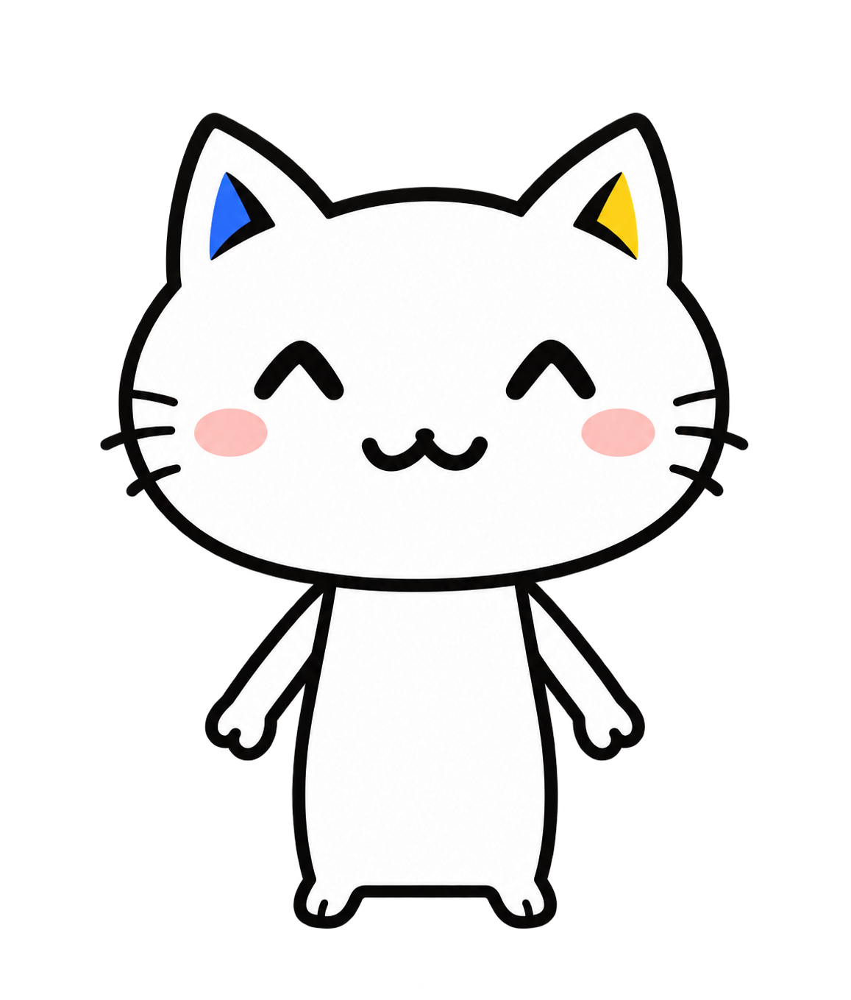

# Luminous 猫猫正式原型

用户于 2026-10-11 明确确认：这是 Luminous 猫猫的正式原型，角色形象很重要。

**后续所有新动作以 [luminous-cat-master.png](luminous-cat-master.png) 为唯一造型基准。** 原型采用透明 PNG；它与用户确认的 [第二版原型](luminous-cat-prototype-original-head-v2-20261011.png) 内容完全一致。

## 必须保留的角色特征

- 白色主体，清晰的黑色漫画轮廓。
- 较宽的脸型、耳朵之间的低弧线，三角耳与头部轮廓连成整体。
- 左耳小蓝色块、右耳小黄色块，其余耳部保持白色。
- 原型中的笑眼、小鼻子、双弧线嘴巴与粉色脸颊；动作表情变化时保持五官的结构与比例。
- 大头、窄身体、细手臂、小手；两只脚仅是身体底部的小延伸。
- 不画成肥大的圆脚、圆形脚底或粗壮四肢，不添加多余肢体。

具体比例以原图为准。生成动作时，正式原型是角色身份与身体比例参考；动作草图只负责姿势，不得覆盖角色外形。

## 后续动作与页面流程

1. 使用正式原型作为参考，按页面用途生成动作。
2. 先提供图片和拟放位置，让用户检查角色是否一致。
3. 用户确认后再嵌入页面。

用户已认可 `page-cats/preview.html` 中提出的页面位置，但指出那批素材的脚过于肥大。那批图仅保留作历史动作草稿，不能直接当作正式角色素材使用；后续需要按本原型重做。

按正式原型重新制作的七个动作保存在 [page-cats-v2](page-cats-v2/README.md)，原型与动作对照见 [第二版预览](page-cats-v2/preview.html)。用户于 2026-10-11 授权嵌入，七个动作已接入约定页面。

## 来源与归档

猫猫角色 Cos 的 [第一版头像定稿](avatar-cos-v1/approved-v1.md) 共九款，确认于 2026-10-14，素材选择已完成，页面接入另行实施。

- 生成方式：内置 image_gen 工具。
- 完整提示词：[第二版生成提示词](luminous-cat-prototype-original-head-v2-20261011.prompt.txt)。
- 用户确认版本：`luminous-cat-prototype-original-head-v2-20261011.png`。
- 稳定引用文件：`luminous-cat-master.png`。
- 首页和侧栏已改用 [原型重制素材](home-sidebar-v2/README.md)，历史插画保留作归档。实际引用位于 `frontend/public/illustrations/cats/`。
